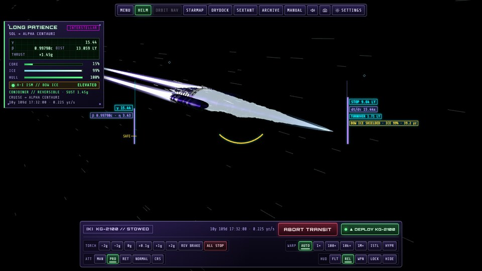
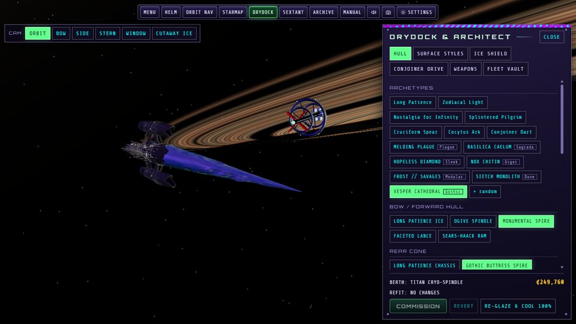
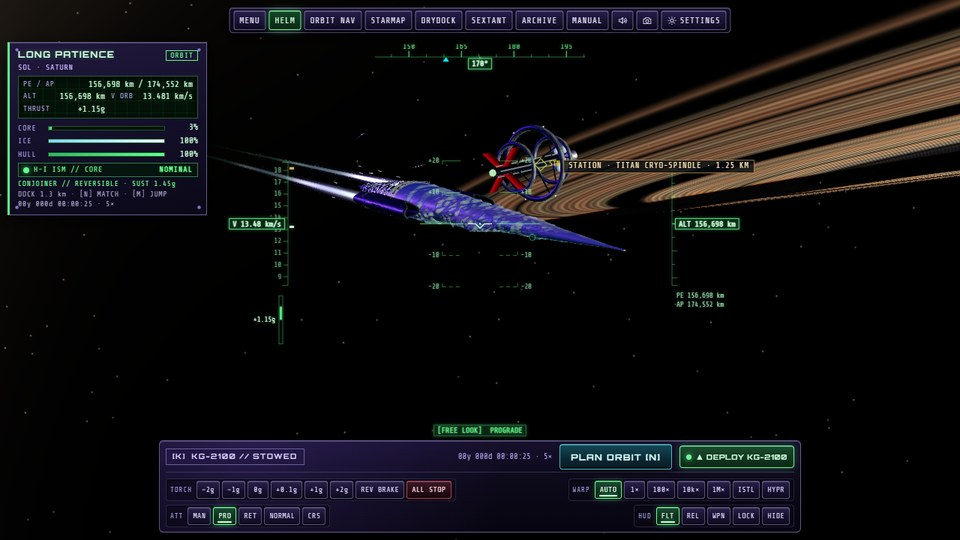
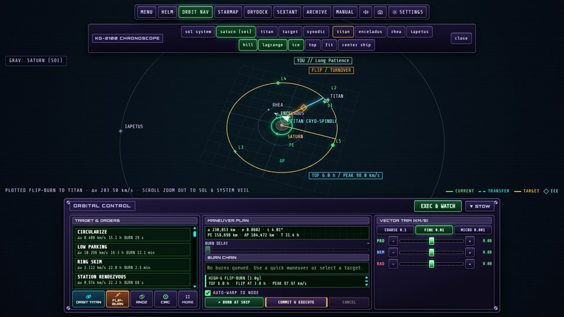
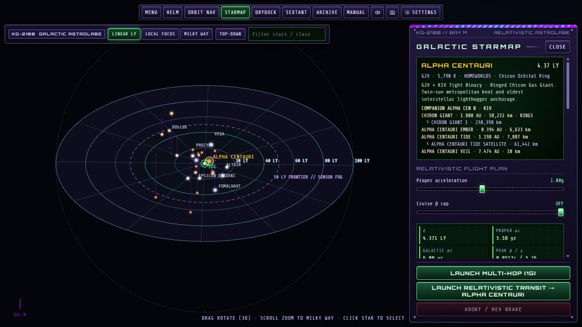
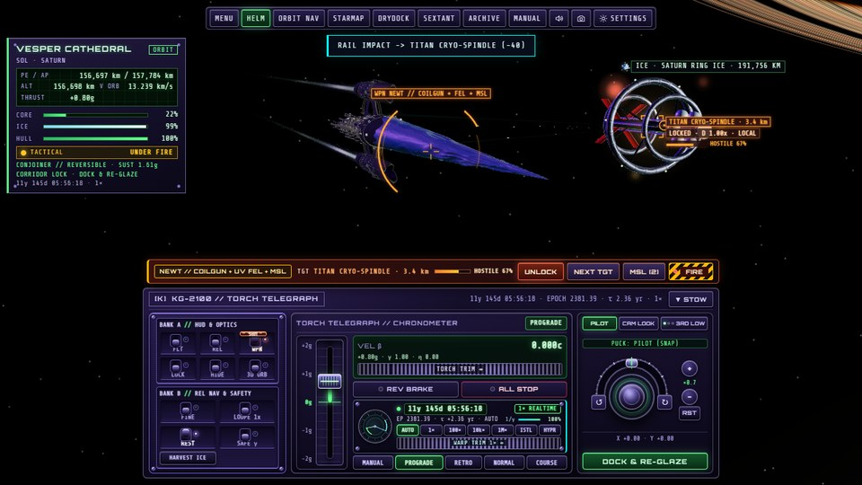

# LAMINAR

**Relativistic Conjoiner Lighthugger Simulator** — live at [laminar.lastnpcalex.agency](https://laminar.lastnpcalex.agency).



## Overview

**Laminar** puts you on the bridge of a 3+ km Conjoiner torchship governed by hard orbital and relativistic constraints:

- **Ship Architect & Drydock (`[Y]`)**: Sculpt hulls across seven architectural surface kits (*Melding Plague*, *Sagrada Basilica*, *Sleek Nighthawk*, *Giger Xenomorph*, *Orbital Modular*, *Dune Brutalist*, *Gothic Cathedral*), configure single bow-ice reverse-brake or dual-ice bi-cone flip-and-burn shields, and balance Reactor Power (MW) vs. Radiator Heat (MW) across coilguns, UV FELs, gamma lances, orbital missiles, and automated PDCs.
- **Free Pilot & Camera Controls (`[H]` / `[R]` / `[G]`)**: Left-drag flight stick steering, right-drag independent 3D camera orbit, `[W]/[S]` torch throttle (`-2g` to `+2g`), `[A]/[D]` yaw, `[Z]/[C]` bank roll, and `[Space]/[Q]/[Tab]` tactical fire & missile locks.
- **3D Orbital Chronoscope (`[N]`)**: True conic-section Keplerian transfers, multi-burn chains, Hill spheres, Lagrange points (`L1`–`L5`), synodic/target reference frames, and continuous high-G brachistochrone flip-burns.
- **Milky Way Starmap (`[M]`)**: 28 curated star systems plus an endless rolling 50 LY procedural frontier inside a to-scale 3D Milky Way spiral model.
- **Relativistic Optics & H-I Shielding (`[X]`)**: Real Lorentz aberration, longitudinal Doppler shifting, proper-time dilation, interstellar hydrogen (H-I) Cherenkov bow luminescence, ice harvesting DropShips, and a Balmer-series Sexton Doppler lab.
- **Audio Engine (`[Shift+M]`)**: Procedural cosmic music layered over sculpted NASA Public Domain plasma/radio stems with hull impulse-response convolution.

## Gallery

| Ship Architect `[Y]` | Helm Flight HUD `[H]` |
| :---: | :---: |
|  |  |
| **Orbit Navigator `[N]`** | **3D Starmap `[M]`** |
|  |  |
| **Relativistic Flight `[R]`** | **Orbital Combat `[G]`** |
|  |  |

## Run Locally

Serve the repository root with any static HTTP server (required for WebGL shaders, audio stems, and module loading):

```sh
npx serve .
# or: python -m http.server 8080
```

Then open `http://localhost:8080/`.

### Unit Tests

```sh
node --test prototypes/lighthugger/test/orbits-and-rocket.test.js
```

## Deploy to Cloudflare Workers (`laminar.lastnpcalex.agency`)

This repository includes `wrangler.json` pre-configured for `laminar.lastnpcalex.agency`:

```sh
npx wrangler login
npx wrangler deploy
```
